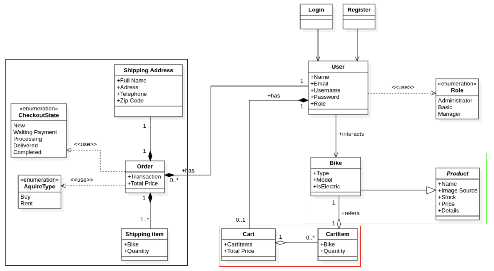
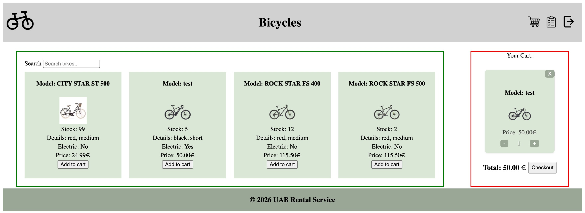
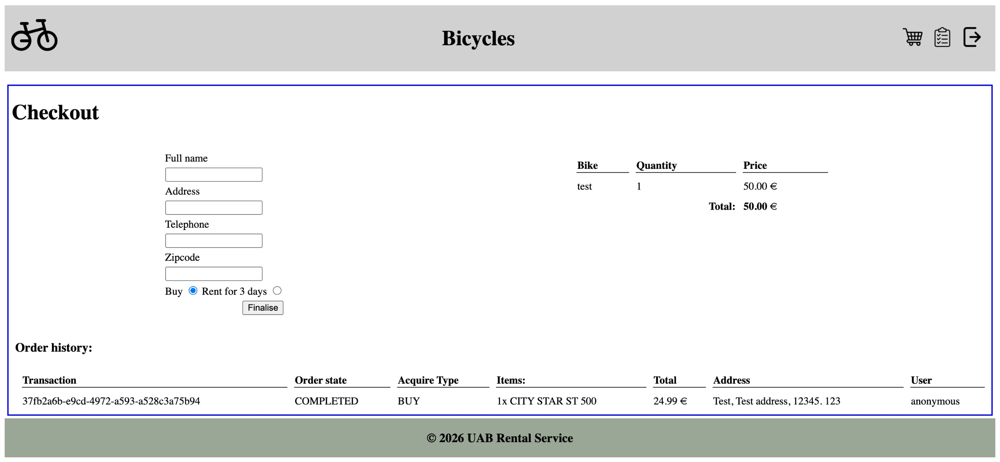

# HtmlFlow Micro-Frontend Examples

Examples of building **micro-frontends (MFEs)** with [HtmlFlow](https://github.com/xmlet/HtmlFlow).

The **shell** application (Quarkus, port `8080`) is built with HtmlFlow. 
It defines the page layout, a header, a footer and the content between. 
Each zone of MFE is defined with `.mfe(cfg -> ...)`,
and is loaded at runtime using the [HtmlFlow MFE engine](https://github.com/xmlet/HtmlFlow/tree/master/htmlflow-mfe-engine).

The stack of the micro-frontends is the following:

| Micro-frontend | Service | Rendered with |
|---|---|---|
| Bikes | `bike-service` (Spring Boot) | [Thymeleaf](https://www.thymeleaf.org/) |
| Cart | `cart-service` (Quarkus) | [Qute](https://quarkus.io/guides/qute) |
| Order | `order-service` (Quarkus) | [HtmlFlow](https://github.com/xmlet/HtmlFlow) |
| Bikes (CSR) | `react-service` (Node, port `8084`) | [React](https://react.dev/), client-side |

## Examples

All examples are in [`shell/src/main/java/com/dev`](shell/src/main/java/com/dev). 
Each one is represented by a class and after running the application can be accessed at the following URLs:

| Example | URL                                                                                    | What it shows |
|---|----------------------------------------------------------------------------------------|---|
| [`WebshopExample`](shell/src/main/java/com/dev/WebshopExample.java) | [`/catalog`](http://localhost:8080/) and [`/checkout`](http://localhost:8080/checkout) | Basic composition |
| [`StreamingExample`](shell/src/main/java/com/dev/StreamingExample.java) | [`/pssr`](http://localhost:8080/pssr)                                                  | Progressive streaming of MFE content |
| [`SharedThemingExample`](shell/src/main/java/com/dev/SharedThemingExample.java) | [`/shared-theming`](http://localhost:8080/shared-theming)                              | One shared theme for all MFEs |
| [`ScriptIntegrityExample`](shell/src/main/java/com/dev/ScriptIntegrityExample.java) | [`/sri`](http://localhost:8080/sri)                                                    | Subresource Integrity for an MFE script |
| [`CsrSsrExample`](shell/src/main/java/com/dev/CsrSsrExample.java) | [`/csr-ssr`](http://localhost:8080/csr-ssr) | A client-side rendered (React) MFE talking to an SSR MFE |

### Basic composition — `WebshopExample`

The home page (`/catalog`) shows a horizontal split that contains two MFEs side by side: **Bikes** and **Cart**. 
When you add a bike, the Bikes MFE
emits `triggerCartEvent` and the Cart MFE reacts to by adding the bike to the cart and refreshes itself. 
The MFEs never call each
other directly; they only share event names. 
The `/checkout` endpoint shows the **Order** MFE alone.

### Progressive streaming — `StreamingExample`

Instead of waiting for the whole Bikes list, the content is streamed and shown to the user as it arrives
using the PSSR technique.

```java
cfg.setMfeUrlResource("http://localhost:8081/bikes/stream");
cfg.setMfeStreamingData(true);
```

### Shared theming — `SharedThemingExample`

Each MFE keeps its own stylesheet, but all of them also receive the same shared stylesheet
([`shared-theme.css`](shell/src/main/resources/META-INF/resources/shared-theme.css)) with common CSS
variables (colours, fonts, spacing) making the whole page look consistent.

```java
cfg.setMfeSharedStylingUrl("http://localhost:8080/shared-theme.css");
```

### Script integrity — `ScriptIntegrityExample`

The shell pins the expected hash of the Bikes MFE script. The browser only runs the script if its content
matches the hash. This blocks a modified or compromised script from being executed. HtmlFlow renders it as
`<script ... integrity="sha384-..." crossorigin="anonymous">`.

```java
cfg.setMfeScriptIntegrity("sha384-V2ag7/4EijBSAnk4OKfVF/m6RyGGLL/89NzKVAnTKNyZbBBQOgqjuBTELQsQETnv");
```

If `mfe-bikes.js` changes, regenerate the hash with:

```bash
echo "sha384-$(openssl dgst -sha384 -binary bike-service/src/main/resources/static/js/mfe-bikes.js | openssl base64 -A)"
```

### CSR + SSR — `CsrSsrExample`

The Bikes MFE is re-implemented in React ([`react-service`](react-service)) and is **fully client-side
rendered**, while the Cart MFE stays the server-side rendered Qute fragment. The React fragment
(`/bikes/view`) is only a mount point. React renders the catalog in the engine's shadow root and fetches
the bikes from the Java `bike-service` JSON API (`GET http://localhost:8081/bikes`).

"Add to cart" emits `triggerCartEvent` with the same payload as the Thymeleaf Bikes MFE. The Cart MFE
listens to it, adds the bike through the cart-service and the engine reloads its SSR fragment:

```java
cfg.setMfeUrlResource("http://localhost:8084/bikes/view");   // empty mount point
cfg.setMfeScriptUrl("http://localhost:8084/js/mfe-bikes.js"); // React bundle (ES module)
cfg.setMfeTriggersEventName("triggerCartEvent");
```

## Running

To run the web-shop application, you can use the docker compose file in the root directory:

```bash
docker compose up --build
```

Access them at: <http://localhost:8080/> with the URIs listed [above](#examples).

## The Application

The examples run on top of a [**Bike Shop**](https://github.com/Florins13/software-engineering) that was built for a master's course in software
engineering. It started as a monolithic, server-side rendered application and was later split into
micro-frontends and microservices. It has four features:

1. **Product catalog** — list the bikes and add one to the cart
2. **Cart** — view and change the cart (quantity, remove items)
3. **Checkout** — submit an order by filling the checkout form
4. **Order history** — list the orders placed by the user

Using **Domain-Driven Design (DDD)**, the application was split vertically into three subdomains:
**Bikes** (catalog and stock), **Cart** (cart state and pricing) and **Order** (order submission and history).
Each subdomain defines both a micro-frontend and a microservice allowing each team to develop, test and deploy
independently. Authentication is simplified to a hardcoded user sent in a request header.

<p align="center"></p>

After the backend was split, the frontend was migrated to micro-frontends. The home page combines the
Bikes and Cart MFEs:

<p align="center"></p>

and the checkout page shows the Order MFE:

<p align="center"></p>

At checkout, the Order service reads the cart from the Cart service over REST and then runs a saga over
Kafka.

